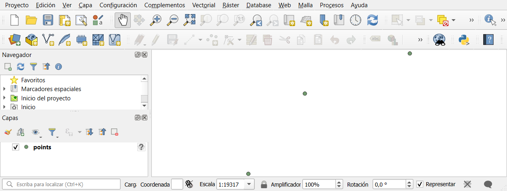

# Laudo 043: fundacao do build do QGIS 3.44.13

Briefing `qgis-build #043` (D-IMAN-040). Branch `feat/043-fundacao-do-build`, PR #1 contra `develop`.
Maquina: Windows 11 Pro, 24 processadores logicos, 32 GB de RAM. Medicoes de 2026-10-23.

Legenda: **medido** (rodado e observado nesta maquina, com a evidencia indicada), **relatado** (dito por fonte
externa ou estimado, nao medido aqui), **N/E** (nao executado).

## Veredito

**`VIÁVEL COM RESSALVA`**: o 3.44.13 compila sem mudanca no fonte, do clone limpo ao binario, por script, em 31 min,
e o binario passa no smoke e e igual ao oficial em versoes, provedores e plugins. Ressalva: **as dependencias tem
de ficar fixadas**, porque com o OSGeo4W de hoje o build quebra (SIP 6.17.1); o cache que garante isso esta so
nesta maquina; e o compilador esta fixado no toolset 14.44, nao no build exato do oficial.

## A pergunta

Conseguimos compilar o QGIS 3.44.13, sem nenhuma mudanca no fonte, nesta maquina, por um script versionado com as
dependencias fixadas, e o binario resultante abre, roda um algoritmo nativo e carrega um projeto?

## Caminho escolhido: (b) CMake manual contra o OSGeo4W fixado

| | (a) receita `qgis-ltr` do jef-n/OSGeo4W | (b) CMake manual |
|---|---|---|
| Versao do QGIS | a receita escolhe sozinha a tag LTR mais nova (`git ls-remote` + `sort -V`): hoje seria a 3.44.15, nao a 3.44.13 | o fonte deste repo, na tag 3.44.13 |
| Dependencias | `osgeo4w-setup --upgrade-also` contra o mirror: sempre as mais novas | lock com versao e sha256, cache local |
| Ambiente | exige Cygwin (bash, `cygpath`, flex e bison do Cygwin) | PowerShell, ferramentas portateis |
| Saida | pacotes OSGeo4W (desktop, server, pdb, devel) | `install\apps\qgis-ltr` no mesmo layout do oficial |

Fixar (a) exigiria editar a receita. O (b) reaproveita as flags de CMake da receita no commit fixado
`jef-n/OSGeo4W@b17db5511a9a` e troca so o que nao e build: escolha de versao, instalacao de dependencia e
empacotamento. Recomendacao: **(b)**. Medido.

## Pre-requisitos instalados (com o "sim" do sponsor na sessao)

| Item | Versao | Tamanho | Onde | Estado |
|---|---|---|---|---|
| VS 2022 Build Tools: `VC.Tools.x86.x64`, `Windows11SDK.26100`, `VC.ATL` (os componentes de `vs2022env()` da receita) | 17.14.42 (`17.14.37806.7`), toolset MSVC 14.44.35207, `cl` 19.44.35229, SDK 10.0.26100.0 | 12,2 GB a menos no C: (VS, SDK e Installer) | `C:\Program Files (x86)\Microsoft Visual Studio\2022\BuildTools` | medido, instalado em 7 min 55 s |
| CMake | 3.29.0 (o da receita), sha256 confere com o `cmake-3.29.0-SHA-256.txt` oficial | 43,6 MB zip | `D:\iman-terra-build\tools` | medido |
| ninja | 1.10.2 (o da receita) | 0,25 MB zip | idem | medido |
| winflexbison | 2.5.25 (flex 2.6.4, bison 3.8.2, as mesmas do Cygwin) | 1,0 MB zip | idem | medido |
| Pacotes OSGeo4W | 156, ver abaixo | 601,8 MB baixados, 2,2 GB extraidos | `D:\iman-terra-build\cache` e `\osgeo4w` | medido |

Por que winflexbison e nao Cygwin: zip portatil, sem instalador nem registro, com as mesmas versoes de flex e bison;
o fonte ja define `YY_NO_UNISTD_H` nos tres lexers (`src/core/*.ll`). O custo apareceu no build: ver "Problemas".

Nada foi instalado em `C:\Program Files\QGIS 3.44.13` nem em `C:\OSGeo4W`. O VS Build Tools instala tambem o
Visual Studio Installer e o VC++ Redistributable do sistema (relatado pela Microsoft; o QGIS oficial usa o runtime
da propria pasta `bin`).

## Dependencias fixadas

`iman/build/osgeo4w.lock.tsv` (156 linhas, versao, URL, tamanho e sha256), gerado por
`iman/build/Resolve-Osgeo4wLock.ps1`:

1. Raizes: `BUILDDEPENDS` e os `requires` de `qgis-ltr-common` da receita no commit fixado, fechados pelos
   `requires:` do `setup.ini` do mirror.
2. Versao de cada pacote:
   - **official** (118 pacotes): a versao gravada no `etc\setup\installed.db` do QGIS 3.44.13 oficial instalado;
   - **dated** (38 pacotes, os `-devel` e os so de build): o tarball mais novo publicado ate o instante do pacote
     `qgis-ltr-3.44.13-1.tar.bz2` oficial (2026-08-01 10:18:01 UTC), ou seja, o que o build oficial tinha a mao.
3. Validacao da regra: para os 118 pacotes do oficial, a regra "dated" escolhe **exatamente** a versao do
   oficial (118 de 118). Cada `-devel` saiu na mesma versao do runtime correspondente (ex.: `gdal-devel-3.13.2-1`
   com `gdal-3.13.2-1`, `qt5-devel-5.15.13-2` com `qt5-libs-5.15.13-2`). Medido.
4. O mirror lista no `setup.ini` so as versoes `curr` e `prev`, mas guarda os tarballs antigos (o diretorio da
   `gdal-devel` guarda versoes desde janeiro de 2025). Os 159 tarballs do instalador oficial estavam todos no servidor em
   2026-10-23. Medido.
5. O lock e reprodutivel: regenerado, sai com as mesmas 156 versoes. Medido.

O cache local (`D:\iman-terra-build\cache\osgeo4w`, 601,8 MB) e conferido por sha256 a cada build; com o cache, o
build roda sem rede (`-Offline`). O cache esta so nesta maquina: guarda-lo em outro lugar e decisao do sponsor.

Versoes principais (iguais as do oficial, medido em `qgis_process --version` dos dois):
Qt 5.15.13, Python 3.12.13, GDAL 3.13.2, PROJ 9.8.1 (EPSG v12.029), GEOS 3.14.1, SQLite 3.53.4, GRASS 8.5.0,
PDAL 2.10.0, SIP 6.15.3, PyQt5 5.15.11.

## O script

Tudo em `iman/build/`, PowerShell 7. Entrada unica, do clone limpo ao binario:

```
pwsh -File iman/build/Invoke-ImanBuild.ps1 -Clean -Smoke [-WorkRoot D:\iman-terra-build]
```

| Script | Faz |
|---|---|
| `Common.ps1` | caminhos (tudo fora do repo, em `$WorkRoot`), ferramentas fixadas com sha256, componentes do VS, ambiente do vcvars |
| `Resolve-Osgeo4wLock.ps1` | gera o lock (roda so quando a base muda); `-Latest` gera o lock "de hoje" para comparacao |
| `Install-BuildTools.ps1` | VS Build Tools (pula quando ja completo, sem UAC) e as ferramentas portateis |
| `Get-Osgeo4wPackages.ps1` | baixa o lock, confere sha256, extrai a raiz OSGeo4W e roda os postinstall; `-Offline` |
| `Build-Qgis.ps1` | configura com as flags da receita, compila com ninja (retomavel), instala |
| `Invoke-Smoke.ps1` | smoke com perfil descartavel; `-Target Official` faz a comparacao com o oficial |
| `Test-OfficialQgisUntouched.ps1` | guarda: retrato do QGIS oficial, de `%APPDATA%\QGIS` e do registro `QGIS` |
| `Test-Patchset.ps1` | `iman/PATCHES.md` contra `git diff final-3_44_13..HEAD` |
| `Invoke-Gate.ps1` | gate proposto |
| `Invoke-ImanBuild.ps1` | orquestra os passos, cada um num `pwsh` filho |

Diferencas declaradas contra a receita oficial (em `Build-Qgis.ps1`):

- sem CDash (`BUILDNAME`, `SITE`, `SUBMIT_URL`, `PUSH_TO_CDASH`);
- `/D _DISABLE_CONSTEXPR_MUTEX_CONSTRUCTOR` na linha de comando, no lugar da edicao dos cabecalhos `<mutex>` do
  MSVC que a receita faz. Motivo: o runtime que o oficial embarca e o `msvcp140` 14.38, mais velho que o
  compilador 14.44; sem o define, um `std::mutex` construido em tempo de compilacao quebra no runtime antigo;
- `GITCOMMAND` apontando o git do sistema (o PATH do `o4w_env` nao tem git; sem isso o binario sai com
  "code revision unknown");
- `CMAKE_INSTALL_PREFIX` em `$WorkRoot\install\apps\qgis-ltr`.

## Tempos e disco

### Do clone limpo ao binario (medido, 2026-10-23 11:27 a 11:58)

Clone parcial do repo publico no commit `101ee62d48`, raiz de trabalho nova e vazia
(`D:\iman-terra-build-clean`, sem cache), `Invoke-ImanBuild.ps1 -Clean -Smoke`, sem nenhum passo manual:

| Passo | Tempo |
|---|---|
| `git clone --filter=blob:none` | ~1 min |
| Ferramentas portateis (download, sha256, extracao; VS ja completo) | 14 s |
| 156 pacotes OSGeo4W (download e sha256) | 32 s |
| Extracao e postinstall da raiz OSGeo4W | 64 s |
| `cmake` configure | 144 s |
| **Build limpo** (4447 passos ninja, paralelismo padrao em 24 nucleos) | **1353 s (22 min 33 s)** |
| `cmake --install` | 123 s |
| Smoke completo | 54 s |
| **Total** | **30 min 58 s** |

### Incremental (medido)

| Caso | Tempo |
|---|---|
| Um `.cpp` do nucleo tocado (`src/core/qgsapplication.cpp`): 1 objeto + relink do `qgis_core.dll` | 26 s de build (o script soma ~2 s de ambiente) |
| Mudanca nos argumentos do CMake (o `GITCOMMAND`): reconfigure + o que depende do `qgsversion.h` | 146 s configure + 38 s build + 282 s install |

### Disco (medido)

| Area | Tamanho |
|---|---|
| Fonte (arvore de trabalho, sem `.git`) | 1,2 GB |
| `.git` (clone parcial `--filter=blob:none`) | 610 MB |
| Cache de pacotes OSGeo4W | 652 MB |
| Ferramentas portateis extraidas | 129 MB |
| Raiz OSGeo4W extraida | 2,2 GB |
| Build (`/Z7`, como a receita), dos quais 1,2 GB de PDB | 14,9 GB |
| **Saida** (`install\apps\qgis-ltr`) | **0,4 GB** |
| VS Build Tools + Windows SDK, no C: | 12,2 GB (queda do livre no C:; 1,6 GB na pasta do VS e 1,7 GB em `Windows Kits\10`) |

Uma raiz de trabalho completa ocupa cerca de 18 GB no D:. Disco livre no fim das medicoes (com as tres raizes: principal, clone limpo e "latest"): C: 259 GB, D: 115 GB; o piso de 50 GB do briefing nao foi tocado.

## Smoke

Sempre com perfil descartavel numa pasta nova (`QGIS_CUSTOM_CONFIG_PATH`, `--profiles-path`, perfil
`iman-smoke`). Evidencia em `evidence/`.

| Passo | Resultado | Estado |
|---|---|---|
| `qgis_process --version` | `QGIS 3.44.13-Solothurn`, `code revision` = commit HEAD do fork (BL-6) | medido |
| Provedores do Processamento | `3d, gdal, model, native, pdal, qgis, script`, 426 algoritmos | medido |
| Plugins (`qgis_process plugins`) | `grassprovider`, `processing` | medido |
| `native:buffer` no `smoke/fixtures/points.geojson` | exit 0, 3 feicoes `MultiPolygon` (conferido com `ogrinfo`) | medido |
| Abre a janela e carrega `smoke.qgz` | janela visivel, projeto lido, camada `points` valida, 3 feicoes, EPSG:4326; o QGIS fecha sozinho com exit 0 em 21 a 24 s | medido |
| Guarda do QGIS oficial | arquivos de `C:\Program Files\QGIS 3.44.13`, `%APPDATA%\QGIS` e `HKCU\Software\QGIS` identicos ao retrato (37432 itens) | medido |

Captura da janela (a interface segue a localidade do Windows desta maquina, espanhol):



### Comparacao com o QGIS 3.44.13 oficial

O oficial foi executado (`qgis_process --version`, `--json list`, `--json plugins`) com perfil descartavel, com
autorizacao do sponsor na sessao; a guarda, rodada depois, nao acusou mudanca no oficial. Medido.

| | Oficial | Compilado | |
|---|---|---|---|
| Versao | 3.44.13-Solothurn | 3.44.13-Solothurn | igual |
| Code revision | `2c8a7782a96` (commit da tag) | commit do fork (`101ee62d48` no smoke do clone limpo, em `evidence/`) | esperado: o fork tem o harness por cima da tag, sem mudar o fonte |
| Qt, Python, GDAL, PROJ, GEOS, SQLite | 5.15.13, 3.12.13, 3.13.2, 9.8.1, 3.14.1, 3.53.4 | iguais | igual |
| Provedores | 7, 426 algoritmos | 7, 426 algoritmos, mesmos IDs | igual |
| Plugins | `grassprovider`, `processing` (pastas: `db_manager`, `grassprovider`, `MetaSearch`, `processing`) | iguais | igual |
| DLLs de provedor (`apps\qgis-ltr\plugins`) | mesma lista dos dois lados | mesma lista dos dois lados | igual |
| `apps\qgis-ltr\bin` | `qgis.reg`, `qgis.reg.tmpl`; o `qgis.exe` vira `bin\qgis-ltr-bin.exe` | `qgis.exe`, servidor (`qgis_server.dll`, `qgis_mapserver.exe`, `qgis_mapserv.fcgi.exe`) e o runtime do MSVC 14.44 (`msvcp140*.dll`, `vcruntime140*.dll`, `concrt140.dll`) | empacotamento, ver "Divergencias" |

## Matriz de estados

| Estado | O que aconteceu | Estado |
|---|---|---|
| **Dependencias iguais as do 3.44.13 oficial** (o lock) | Compila do clone limpo (22 min 33 s) e passa no smoke completo, duas vezes (raiz de trabalho principal e raiz nova a partir do clone). Versoes de Qt, Python, GDAL, PROJ, GEOS e SQLite, provedores, algoritmos e plugins identicos aos do oficial. | medido |
| **Dependencias mais novas** (o OSGeo4W de 2026-10-23: 54 dos 156 pacotes mudaram, lista em `osgeo4w-latest.lock.tsv`) | **Nao compila.** O `sip-build` do SIP 6.17.1 (o oficial usou 6.15.3) recusa `python/core/auto_generated/qgsmaplayerlegend.sip` linha 165: *"'QgsMapLayerLegendUtils::legendNodeCustomSymbol' the mapped type result needs an assignment operator or be movable"*. Caem os 5 alvos de bindings Python (`_core`, `_gui`, `_analysis`, `_server`, `_3d`). Rodado com `-KeepGoing` (`ninja -k 0`): **todo o C++ compila e linka** contra GEOS 3.15.0, GDAL 3.13.3, OpenSSL 3.5.9 e Python 3.12.15 (3413 de 3548 passos; os restantes dependem dos bindings). O unico bloqueio e o SIP. Contornar exigiria mudar o fonte do QGIS (fora desta fatia) ou fixar o SIP, que e o que o lock ja faz. Smoke: N/E (sem bindings nao ha PyQGIS nem os provedores Python). | medido |
| | Contexto: o SIP 6.17.0 saiu no OSGeo4W em 2026-10-08, depois do ultimo `qgis-ltr` empacotado (3.44.15, em 2026-09-26); nenhum QGIS LTR oficial do OSGeo4W foi compilado com ele ate hoje. O `patch` da receita `qgis-ltr` esta vazio. | medido (datas do mirror) |
| **Dependencia ausente ou removida do OSGeo4W** | Hoje nao ha: os 159 tarballs do instalador oficial e os 156 do lock estao no mirror. Simulado numa raiz separada: (1) pacote fora do cache com `-Offline`: para antes de extrair, nomeando o pacote; (2) lock apontando versao que o mirror nao tem: para com HTTP 404 e a URL; (3) o mesmo pacote guardado no cache local: passa sem rede; (4) tarball adulterado no cache: para com `sha256 divergente`. Onde quebra: sempre em `Get-Osgeo4wPackages.ps1`, antes do build. Pacote guardado resolve: sim, desde que o cache exista (hoje, so nesta maquina). | medido (simulado) |
| **Build interrompido no meio** | `ninja` e `cl` mortos no passo 1859 de 4415; a nova chamada de `Build-Qgis.ps1` (sem `-Clean`) **retomou** com 2565 passos restantes e terminou. `-Clean` recomeca do zero. Ressalva medida: um arquivo gerado pode ficar corrompido e ainda assim "atualizado" para o ninja (caso do `win_flex`, ver "Problemas"); na duvida, `-Clean`. | medido |

## Divergencias do build oficial

| Divergencia | Medida | Efeito | Onde tratar |
|---|---|---|---|
| Patch do compilador | oficial: `cl` 19.44.35225 (Rich header do `qgis_core.dll`); aqui: 19.44.35229 | mesmo toolset 14.44; o bootstrapper do VS instala o patch corrente do canal 17 | fixar o compilador exato exige um layout offline do VS (alguns GB), nao feito: decisao do sponsor |
| Runtime do MSVC | o `cmake --install` copia o runtime 14.44 para `apps\qgis-ltr\bin`; o oficial nao tem runtime ali e usa o 14.38 de `bin\` | o compilado roda com o 14.44; o define do mutex torna o binario compativel com o 14.38 tambem, mas isso nao foi exercitado | fatia do instalador |
| Servidor | o compilado instala o QGIS Server junto; o oficial o separa no pacote `qgis-ltr-server`, fora do instalador desktop | nenhum no desktop | fatia do instalador |
| `qgis.reg` | o oficial gera, no empacotamento, o `.reg` das associacoes de arquivo | registro do Windows: entra no BL-3 (perfil e registro isolados) | fatia do instalador e de marca |
| Revisao | ver comparacao | identifica o commit publico (BL-6) | ja tratado |

## Problemas encontrados no caminho (e o que foi feito)

1. **`win_flex` em paralelo corrompe a saida.** O winflexbison usa um temporario de nome fixo em `%TEMP%`
   (`~flex_out_main_N`). Com o ninja paralelo, o primeiro build falhou com `error deleting file`; pior, outro
   lexer saiu **corrompido** e foi aceito pelo ninja como atualizado (`yytutate_type` no lugar de `yy_state_type`
   em `qgsexpressionlexer.cpp`), quebrando a compilacao depois. Correcao no script: as seis saidas de flex e bison
   do `src/core` sao geradas antes, em serie; o unico flex do `src/analysis` roda depois, sozinho. Nenhum arquivo
   do QGIS mudou. Medido.
2. **Revisao `unknown`.** Corrigido passando `GITCOMMAND` (ver acima). Medido.
3. **Postinstall que escreve no sistema.** `openssl.bat` e `opencl.bat` rodam `dllupdate -copy -reboot`, que copia
   DLL para `C:\Windows\System32`. Nao rodam: as DLLs ficam no `bin` da raiz isolada, que vai na frente do PATH.
   Os demais postinstall foram lidos antes de rodar: so reescrevem caminhos dentro da raiz ou criam atalhos, que ficam
   desligados por variavel de ambiente. Medido.

## Gate proposto (kind `qgis-build`)

```
pwsh -NoProfile -File iman/build/Invoke-Gate.ps1
```

Um comando, na arvore commitada: `Test-Patchset.ps1` (BL-5), dependencias conferidas por sha256 sem rede
(`Get-Osgeo4wPackages.ps1 -Offline`), build incremental (`Build-Qgis.ps1`) e o smoke completo com a guarda
(`Invoke-Smoke.ps1`). Pre-requisito: a bancada montada uma vez por `Invoke-ImanBuild.ps1`. O registro no
`crew_gate.sh` e do arquiteto.

O gate proposto roda na arvore commitada, depois do push; a saida inteira vai no `/deliver` da fatia.

## Patchset

`git diff --stat final-3_44_13..HEAD -- . ':!iman' ':!.claude' ':!.memory' ':!CLAUDE.md'` vem vazio, e
`Test-Patchset.ps1` sai com `PATCHSET OK` (0 alterados, 0 listados). `iman/PATCHES.md` nasce vazio. Medido.

## O que este spike NAO testou

- **VM limpa (BL-7).** Tudo rodou na maquina de desenvolvimento, que ja tem o QGIS oficial. O binario nao foi
  instalado nem aberto numa VM Windows limpa. N/E.
- **Instalador e pacote.** Nao ha instalador; o binario roda de `install\apps\qgis-ltr` contra a raiz OSGeo4W de
  build. Layout final, runtime embarcado, `qgis.reg`, atalhos e desinstalacao: N/E.
- **Runtime 14.38.** O compilado so rodou com o runtime 14.44 que o install copia. Com o 14.38 do oficial: N/E.
- **Suite de testes do QGIS.** `ENABLE_TESTS=FALSE`, como na receita oficial. Nenhum teste unitario do QGIS rodou. N/E.
- **Funcionalidade alem do smoke.** GRASS dentro do Processamento (o plugin `grassprovider` existe mas aparece
  como nao carregado no `qgis_process`, igual no oficial), Oracle, HANA, PDAL com dado real, 3D, servidor,
  impressao, plugins Python de terceiros: N/E.
- **Compilador exato.** O `cl` do oficial (19.44.35225) nao foi reproduzido; nao ha layout offline do VS. N/E.
- **Outra maquina.** O build nao foi repetido em segunda maquina nem no GitHub Actions (fora de escopo). N/E.
- **Assinatura de codigo, release e Actions:** fora de escopo pelo briefing. N/E.
- **Smoke com as dependencias de hoje.** O build quebra antes (SIP 6.17.1); o binario C++ que saiu nao foi
  executado. N/E.
- **Instalacao do VS do zero na prova do clone limpo.** A prova do clone limpo usou o VS ja instalado; a instalacao
  do VS foi medida uma vez (7 min 55 s), antes. N/E como parte da prova de ponta a ponta.
- **Marca:** nenhuma mudanca de marca; e a proxima fatia. N/E.
